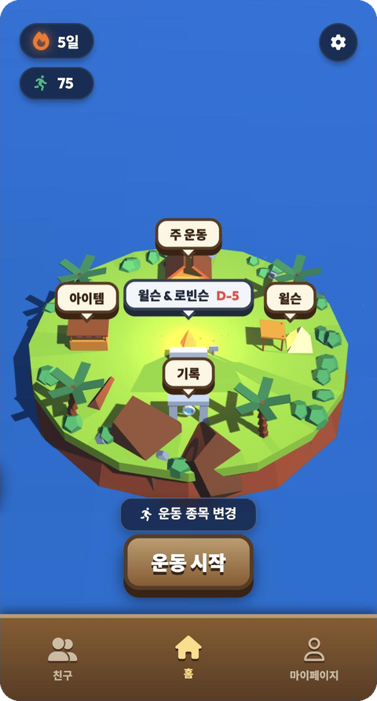
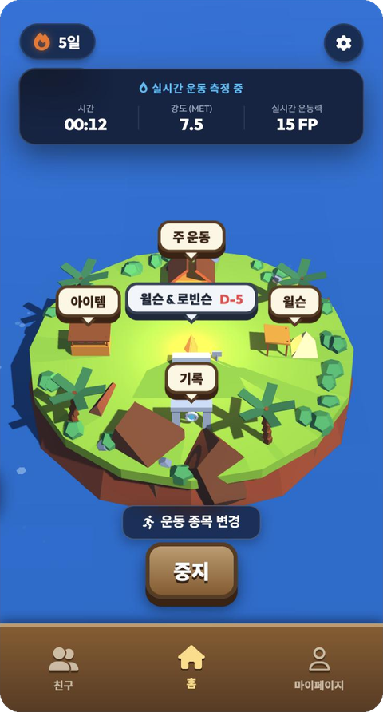
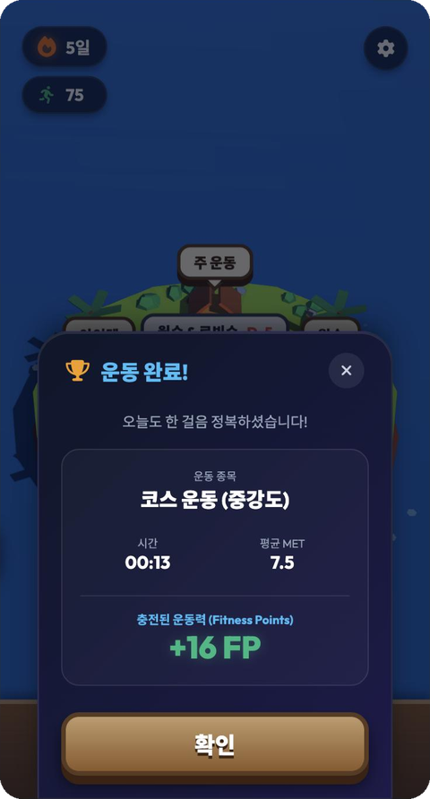
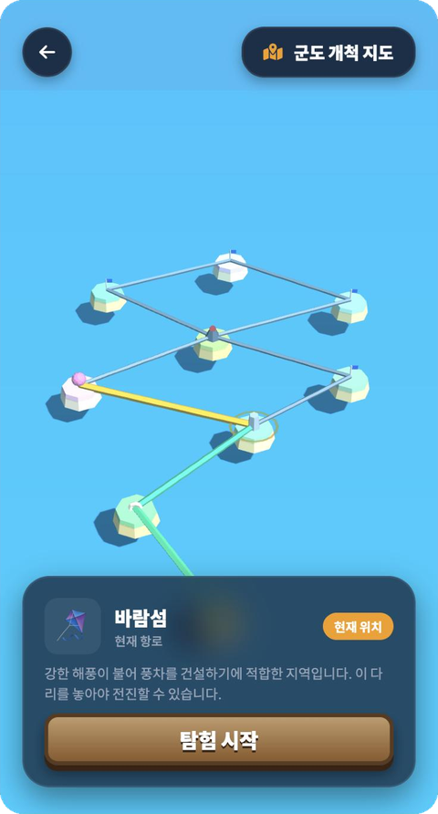
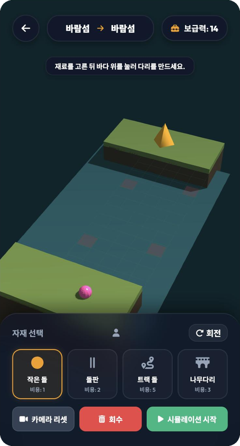
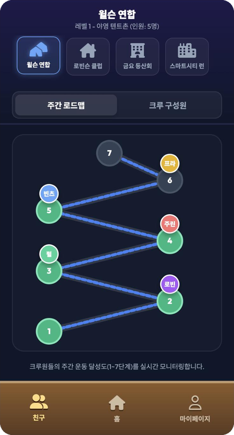
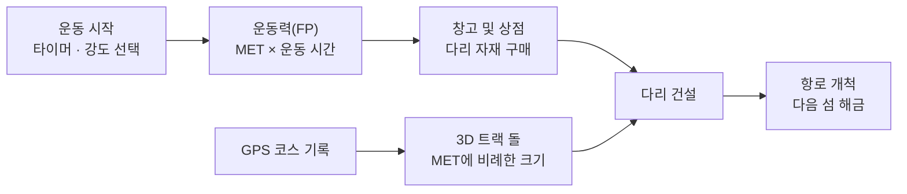

<h1 align="center">CrewSom</h1>

<p align="center">
  운동 기록을 재료 삼아, 크루와 함께 섬을 개척하는 게이미피케이션 피트니스 웹앱
</p>

<p align="center">
  
  
  
  
</p>

<p align="center">
  <a href="https://crew-som.vercel.app"><b>라이브 데모</b></a>
  &nbsp;·&nbsp;
  <a href="https://github.com/JuanHubb/CrewSo">Flutter 버전 (CrewSo)</a>
</p>

<br />

<table>
  <tr>
    <td align="center" width="33%"><br /><sub>홈 섬</sub></td>
    <td align="center" width="33%"><br /><sub>실시간 운동 측정</sub></td>
    <td align="center" width="33%"><br /><sub>운동 완료 · 운동력 충전</sub></td>
  </tr>
  <tr>
    <td align="center"><br /><sub>군도 개척 지도</sub></td>
    <td align="center"><br /><sub>다리 건설 미니게임</sub></td>
    <td align="center"><br /><sub>크루 주간 로드맵</sub></td>
  </tr>
</table>

<br />

## 소개

**CrewSom**은 운동을 하나의 탐험 게임으로 바꾸는 모바일 퍼스트 웹 프로토타입입니다.
**CrewSo**(Flutter 앱)의 WebGL 버전으로, Three.js로 만든 로우폴리 3D 섬 위에서 동작합니다.

- 운동 시간과 강도(MET)는 **운동력(Fitness Points, FP)** 으로 바뀝니다.
- 운동력으로 나무판자·돌·밧줄 같은 **다리 자재**를 삽니다.
- 자재로 섬과 섬 사이에 **다리를 놓아** 군도를 개척합니다.
- 크루원들의 주간 운동 달성도는 **로드맵**으로 한눈에 봅니다.

<br />

## 핵심 루프



<br />

## 화면 구성

### 홈 섬

3D 섬 위 네 개의 오두막이 각 기능으로 이어집니다. 오두막을 누르면 GSAP 카메라가 그쪽으로 확대되고 모달이 열립니다.

| 위치 | 오두막 | 기능 |
| :-: | :-- | :-- |
| 북 | **주 운동** | 운동 종류·강도·시간 설정, GPS 코스 선택, 운동 완료 시 트랙 돌 생성 |
| 동 | **윌슨** | 친구 리스트 검색, 친구 프로필·운동 피드 |
| 서 | **아이템** | 창고 인벤토리, 운동력으로 자재를 사는 상점 |
| 남 | **기록** | 운동 기록 보관소, 오운완 사진 수동 인증 |
| 중앙 | **윌슨 & 로빈슨** | 모닥불을 누르면 Voyage(군도 개척)로 이동 |

**운동 시작**을 누르면 상단에 시간 · 강도(MET) · 실시간 운동력이 표시됩니다. **중지**하면 결과 카드에 이번 운동으로 얻은 FP가 나옵니다.

### Voyage — 군도 개척

- **군도 개척 지도**: 9개의 섬과 10개의 항로를 3D로 보여 줍니다. 현재 위치한 섬에서만 탐험을 시작할 수 있습니다.
- **다리 건설**: 12 × 5 격자 위에 자재를 배치하고 회전합니다. **시뮬레이션 시작**을 누르면 캐릭터가 건너는지 판정합니다. 성공하면 다음 섬과 항로가 열립니다.

### 크루 · 마이페이지

- **크루**: 크루 전환, 1–7단계 **주간 로드맵**(크루원 아바타 위치 표시), 12칸 **크루 구성원** 그리드와 초대
- **마이페이지**: 활동 지수와 누적 FP, GitHub 스타일 운동 **잔디**, 운동 피드

<br />

## 게임 규칙

<details>
  <summary><b>MET · 운동력 계산</b></summary>
  <br />

| 운동 종류 | 저강도 | 중강도 | 고강도 |
| :-- | :-: | :-: | :-: |
| 코스 운동 | 5.0 | 7.5 | 10.0 |
| 실내 운동 | 3.5 | 6.0 | 8.5 |
| 실외 운동 | 3.0 | 5.0 | 8.0 |

- 실시간 측정: `FP = round(MET × 운동 분 × 10)`
- 주 운동 모달에서 기록: `FP = round(MET × 운동 분 × 0.5)`
- GPS 코스를 켜고 기록하면 크기 `MET × 0.15`의 **트랙 돌**이 생깁니다. 코스는 한강 시민공원 · 남산 둘레길 · 여의도 공원 · 북한산 중에서 고릅니다.

</details>

<details>
  <summary><b>상점 · 다리 자재</b></summary>
  <br />

| 상점 자재 | 가격 |
| :-- | --: |
| 튼튼한 밧줄 | 80 FP |
| 나무판자 | 100 FP |
| 단단한 돌 | 150 FP |
| 철광석 | 250 FP |

| Voyage 자재 | 비용 | 차지하는 칸 | 깊은 바다 |
| :-- | :-: | :-: | :-: |
| 작은 돌 | 1 | 1 | — |
| 돌판 | 2 | 2 | — |
| 나무다리 | 3 | 3 | 설치 가능 |
| 트랙 돌 | 5 | 5 (L자) | — |

- 한 번 시도할 때 **보급력 14**를 씁니다. 격자 4–6열은 깊은 바다라 나무다리만 놓을 수 있습니다.
- 자재는 출발 지점이나 이미 놓인 자재에 이어서만 배치할 수 있습니다. 암초 칸에는 놓을 수 없습니다.

</details>

<br />

## 기술 스택

| 영역 | 사용 기술 |
| :-- | :-- |
| 3D 렌더링 | **Three.js r128**: 로우폴리 지오메트리, PCF 소프트 그림자, 정점 변위로 만든 물결, OrbitControls, 레이캐스팅 기반 탭 판정 |
| 애니메이션 | **GSAP 3.12**: 오두막 카메라 줌, 다리 건너기 시뮬레이션 타임라인 |
| UI | 프레임워크 없는 HTML · CSS · JavaScript, 6:11 휴대폰 프레임 레이아웃, Font Awesome, Noto Sans KR · Outfit |
| 상태 저장 | `localStorage`의 `crewsom_state` 키 하나에 앱 상태 전체를 JSON으로 저장 |
| 배포 | Vercel (빌드 단계 없는 정적 호스팅) |

<br />

## 프로젝트 구조

```
CrewSom
├── index.html               # 홈 앱 셸: HUD, 모달, 크루 · 마이페이지 뷰
├── app.js                   # 상태 관리, 3D 섬, 운동 측정 · 점수, 상점, 크루, 프로필
├── style.css
├── voyage/
│   ├── index.html           # 군도 개척 지도 + 다리 건설 화면
│   ├── voyage.js            # 3D 월드맵, 격자 배치 · 판정, 시뮬레이션
│   └── style.css
├── sw.js                    # 서비스 워커 (작업 중)
├── architecture_design.md   # 백엔드 · 협동 모드 설계 문서
└── docs/screenshots/
```

<br />

## 로컬 실행

빌드 단계나 의존성 설치가 없습니다. 아무 정적 서버로 루트 폴더를 열면 됩니다.

```bash
python3 -m http.server 8000
# http://localhost:8000 접속
```

> Three.js, GSAP, 폰트, 아이콘은 CDN에서 불러오므로 인터넷 연결이 필요합니다.

<br />

## 프로토타입 범위와 다음 단계

현재는 **프론트엔드 단독 프로토타입**입니다.

- 크루 · 친구 · 피드는 목업 데이터입니다. GPS는 미리 정한 4개 코스로 대신합니다.
- Voyage의 다리 건설은 홈 섬 인벤토리와 아직 연결되지 않았습니다. 별도의 보급력(14)을 쓰고, 진행 상황은 저장되지 않습니다.
- PWA 설정(`manifest.json`, `sw.js`)은 아직 완성 전입니다.

[`architecture_design.md`](architecture_design.md)에 다음 단계 설계가 정리되어 있습니다.

- PostgreSQL 스키마: 사용자, 운동, 크루, 섬 노드, 다리 세션
- WebSocket 기반 크루 협동 다리 건설
- Flutter + WebView 하이브리드 구조
